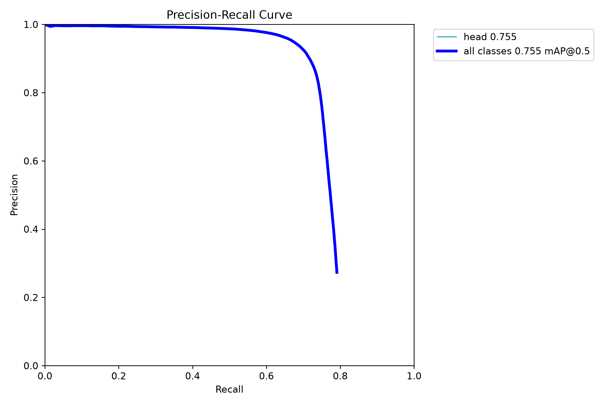
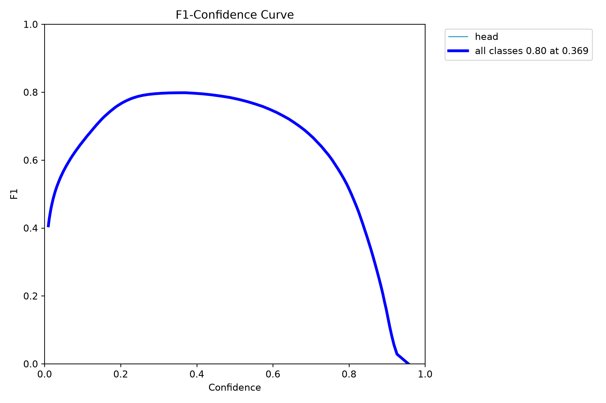
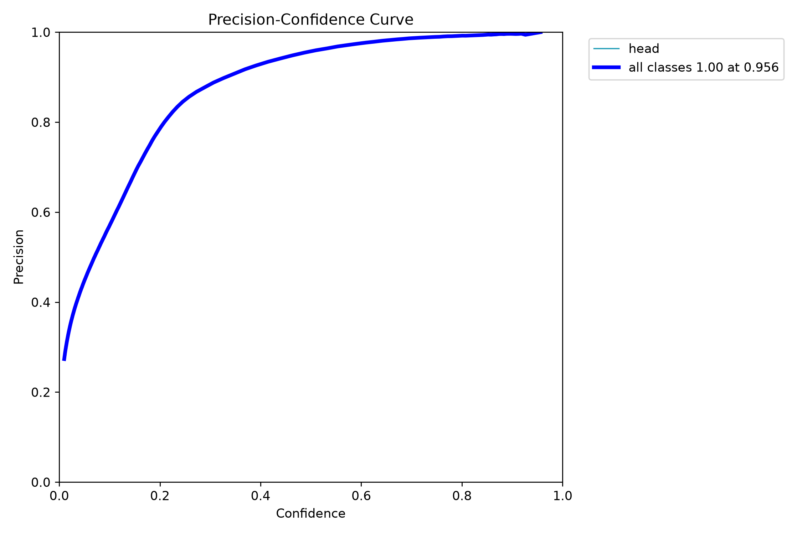
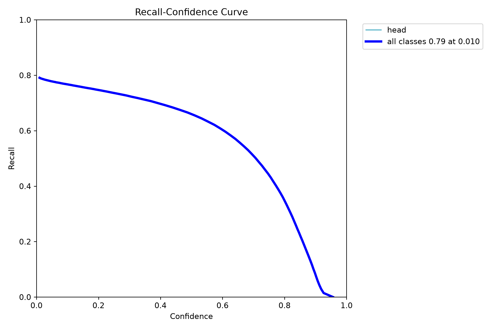
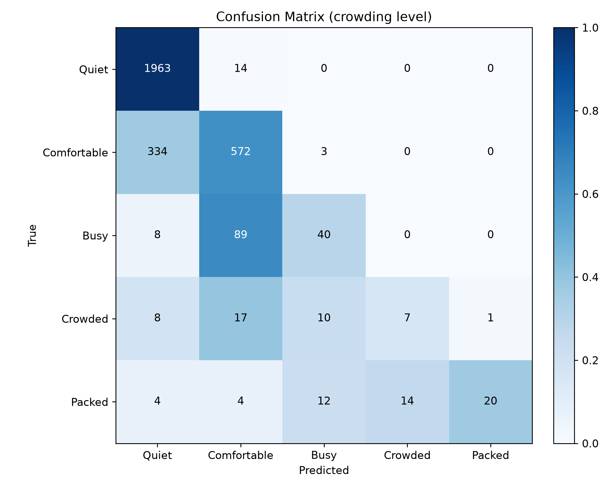
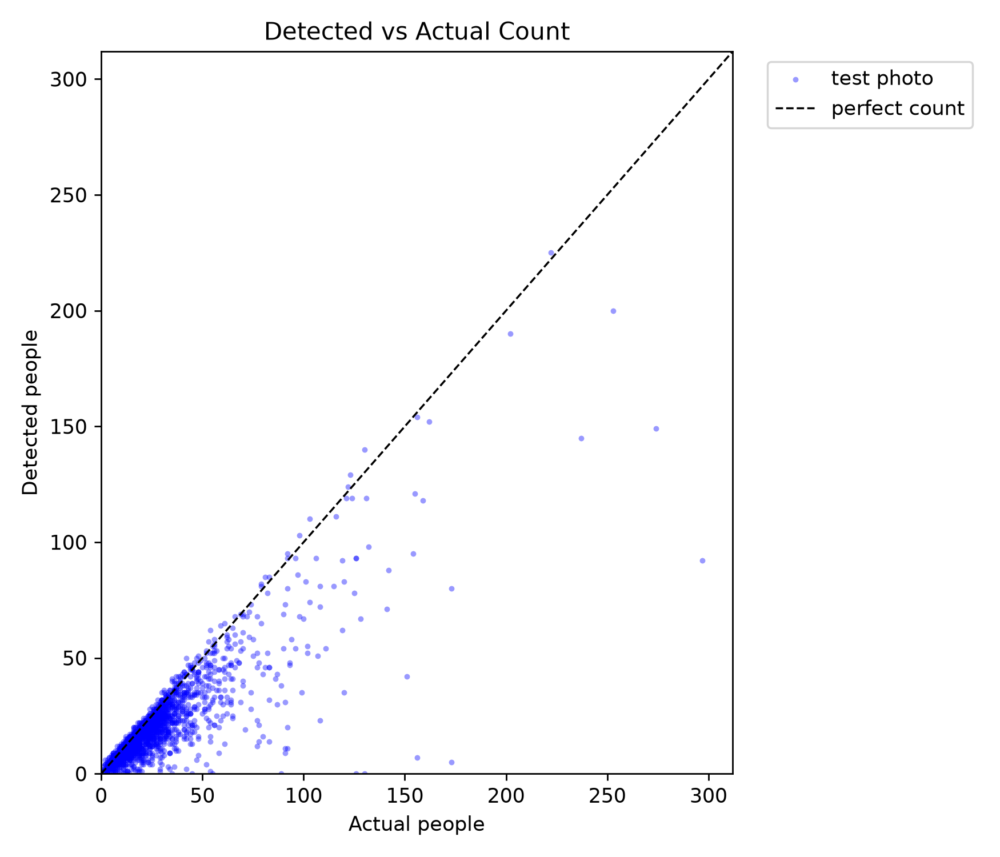
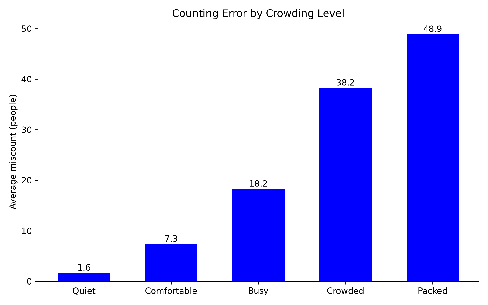

# Figures for the report

Generated by `cd model && uv run python -m aera_vision.figures` from `model/results/summary.json` (2026-11-13 22:44:53).
Model: **YOLOv5m CrowdHuman, heads** (https://github.com/yakhyo/yolov5-crowdhuman-onnx, trained on CrowdHuman train (person and head); licence: No licence file (YOLOv5 code is AGPL-3.0)). Not retrained.
Test data: CrowdHuman validation set (CC BY-NC 4.0 (non-commercial research and education)), 3,120 held-out photos. 250 of the 3370 test photos were not run (the laptop was overloaded and restarted); the scores use the other 3120. The split itself is unchanged.

## fig1_precision_recall.png

Precision-recall curve of YOLOv5m CrowdHuman, heads on 3,120 held-out CrowdHuman photos, detections matched to labelled heads at IoU 0.5. mAP@0.5 0.755, mAP@0.5:0.95 0.458. At the confidence threshold used (0.353): precision 0.910, recall 0.711.

## fig2_f1_confidence.png

F1 of YOLOv5m CrowdHuman, heads against the confidence threshold (3,120 test photos). Highest f1 0.798 at confidence 0.369. The threshold used, 0.353, was chosen as the best F1 on the separate tuning split; on the test photos it gives f1 0.798.

## fig3_precision_confidence.png

Precision of YOLOv5m CrowdHuman, heads against the confidence threshold (3,120 test photos). Highest precision 1.000 at confidence 0.956. The threshold used, 0.353, was chosen as the best F1 on the separate tuning split; on the test photos it gives precision 0.910.

## fig4_recall_confidence.png

Recall of YOLOv5m CrowdHuman, heads against the confidence threshold (3,120 test photos). Highest recall 0.791 at confidence 0.010. The threshold used, 0.353, was chosen as the best F1 on the separate tuning split; on the test photos it gives recall 0.711.

## fig5_confusion_matrix.png

Crowding level from the model's count (predicted) against the labels (true), 3,120 test photos, one photo treated as half a car (100 people when full). Cells show photo counts; colour is the share of each true level. Accuracy 0.834, macro-F1 0.555.

## fig6_counted_vs_actual.png

People detected by YOLOv5m CrowdHuman, heads against the labelled count, one dot per test photo (3,120). Dots below the dashed line are undercounts. Mean absolute error 5.34 people, mean signed error -4.95.

## fig7_model_comparison.png

Precision, recall and F1 of all 11 detectors tested, used as published without retraining, each at the threshold with the best F1 on the tuning split. YOLOv5m CrowdHuman, heads (chosen) scores highest on all three: precision 0.910, recall 0.711, F1 0.798. Head detectors are scored against head boxes, person detectors against visible-body boxes.

## fig8_error_by_level.png

Average counting error per test photo, by crowding level in the labels. Error grows as views fill: Quiet 1.6, Comfortable 7.3, Busy 18.2, Crowded 38.2, Packed 48.9 people. Test photos per level: Quiet 1977, Comfortable 909, Busy 137, Crowded 43, Packed 54.
