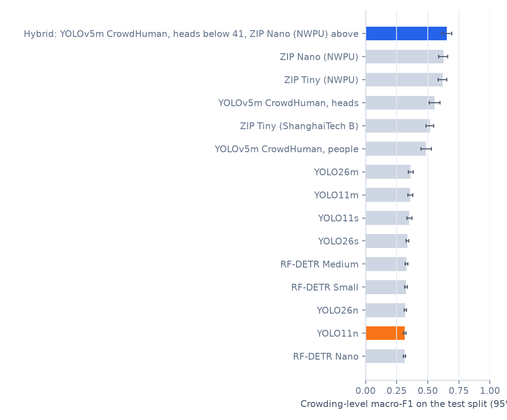
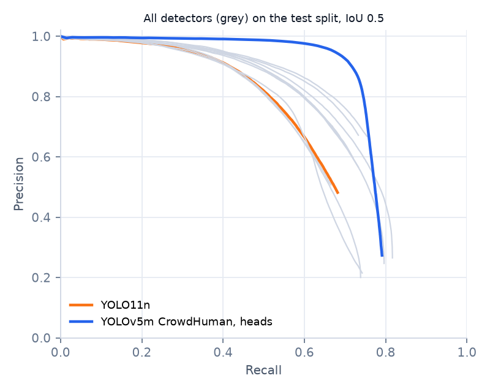
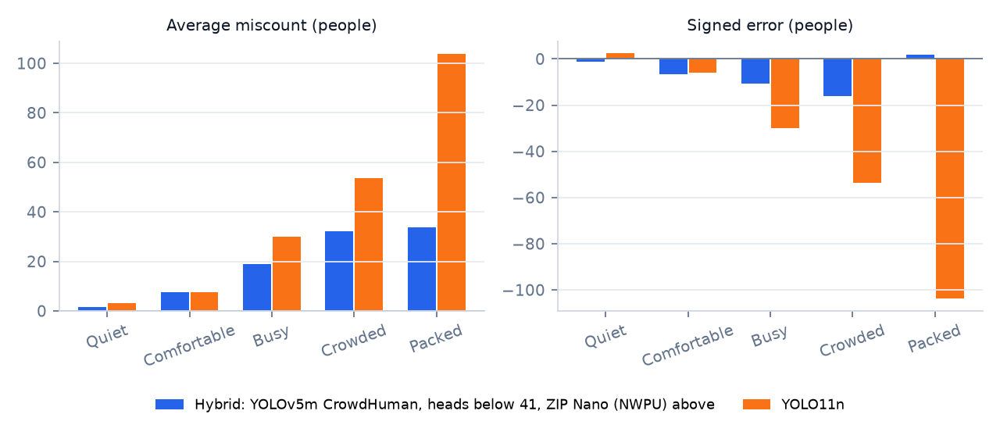
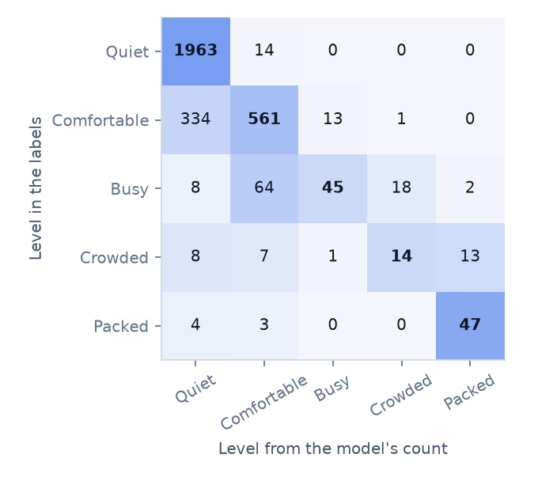
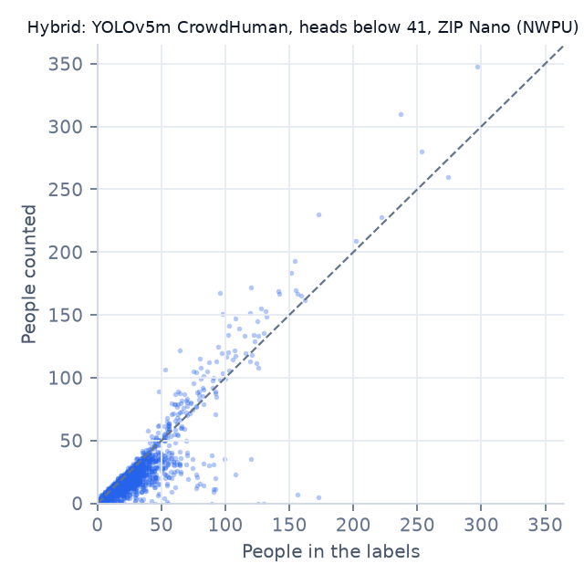

# AERA Vision: model report

Generated by `aera_vision.report` from `results/summary.json` (2026-11-13 22:44:53). Do not edit by hand: rerun `make eval` and every number below is rewritten.

## Summary

We compared 14 ready-trained people counters (no retraining), plus a hybrid of the best two, on 3,120 held-out photos of crowds from CrowdHuman validation set (the other 250 planned test photos were not run). The chosen model is **Hybrid: YOLOv5m CrowdHuman, heads below 41, ZIP Nano (NWPU) above**. On the test photos it puts a camera view in the right crowding level 84.3% of the time (82.9% to 85.5%) (macro-F1 0.65 (0.61 to 0.69)) and miscounts by 5.0 people on average (4.7 to 5.4). Its head detector (YOLOv5m CrowdHuman, heads) finds people with precision 91.0% (90.7% to 91.4%), recall 71.1% (69.6% to 72.5%) and F1 79.8% (78.8% to 80.8%) at IoU 0.5. The person detector AERA's edge code uses today (YOLO11n) scores macro-F1 0.31 (0.30 to 0.32) and miscounts by 8.0 people (7.4 to 8.6). The chosen model's hardest level is Packed (33.8 people off on average). Only 97 test photos are Crowded or Packed, so those numbers are the least certain.

## 1. Question and set-up

Which ready-trained model counts people best in a crowded train car, seen by a camera on the ceiling, and could run on a Raspberry Pi 5 with an AI HAT or a Jetson Orin Nano? AERA shows riders five crowding levels by load (count / capacity): Quiet under 20 %, Comfortable 20-50, Busy 50-75, Crowded 75-95, Packed 95 % and over (`frontend/lib/crowd/levels.ts`). A car holds 200 people. We assume **two cameras per car**, one at each end, each counting its half, so one camera view holds **100 people** at full load and one test photo stands in for one view: level = level(count / 100). The same rule is applied to the labelled count and the model's count.

## 2. Data

- **Test data:** CrowdHuman validation set (https://www.crowdhuman.org; files from https://huggingface.co/datasets/sshao0516/CrowdHuman), licence **CC BY-NC 4.0 (non-commercial research and education)**. 4,120 photos with a box for every person (full body, visible part, head). SHA-256 of the download: `CrowdHuman_val.zip` c0ab99bb80ac162cd3efdf94a1a6100c4f059a61d69596412c6b44ebc20d1363, `annotation_val.odgt` be422c79a190ff7e30fe5cbd74cbf45a2dadda6c5af58c6ec11a038ba2993c04.
- **Split:** fixed once, seed 2026, stratified by level: **tune** 1,000 photos (thresholds, hybrid switch, sensor confidence, choice of model) and **test** 3,120 photos (reported numbers only). The split file is hashed (`34f62148e4b81e4b…`) and the code refuses to run if it changes. **250 of the 3370 test photos were not run (the laptop was overloaded and restarted); the scores use the other 3120. The split itself is unchanged.**
- **Do-not-count zones:** CrowdHuman marks areas it did not label (dense background crowds, reflections, posters) and some people as ignored. A person is counted only if the centre of their box is outside every such zone, for the labels and for every model alike (density counters lose the density inside zones). This removes 7,773 of 99,481 labelled people (7.8%).
- **Training data of the models** (not used here): COCO 2017 for the YOLO and RF-DETR person detectors; CrowdHuman train for the YOLOv5m CrowdHuman model; NWPU-Crowd or ShanghaiTech Part B for ZIP. CrowdHuman, NWPU-Crowd and ShanghaiTech are for research use only.

| Level | Tune photos | Test photos |
| --- | --- | --- |
| Quiet | 640 | 1977 |
| Comfortable | 288 | 909 |
| Busy | 43 | 137 |
| Crowded | 13 | 43 |
| Packed | 16 | 54 |

## 3. Candidates

All used exactly as published. Detectors run at 640 px (Ultralytics, YOLOv5) or their native size (RF-DETR Nano 384, Small 512, Medium 576 px); ZIP runs on the whole photo. Photos longer than 2,048 px are first scaled down to 2,048 px for every model alike.

| Model | What it does | Licence | Trained on | Params (M) | File (MB) | Source |
| --- | --- | --- | --- | --- | --- | --- |
| YOLO11n | person | AGPL-3.0 | COCO 2017 (person class) | n/a | 6 | https://docs.ultralytics.com/models/yolo11/ |
| YOLO11s | person | AGPL-3.0 | COCO 2017 (person class) | n/a | 19 | https://docs.ultralytics.com/models/yolo11/ |
| YOLO11m | person | AGPL-3.0 | COCO 2017 (person class) | n/a | 41 | https://docs.ultralytics.com/models/yolo11/ |
| YOLO26n | person | AGPL-3.0 | COCO 2017 (person class) | n/a | 6 | https://docs.ultralytics.com/models/yolo26/ |
| YOLO26s | person | AGPL-3.0 | COCO 2017 (person class) | n/a | 20 | https://docs.ultralytics.com/models/yolo26/ |
| YOLO26m | person | AGPL-3.0 | COCO 2017 (person class) | n/a | 44 | https://docs.ultralytics.com/models/yolo26/ |
| RF-DETR Nano | person | Apache-2.0 | COCO 2017 (person class) | n/a | 366 | https://github.com/roboflow/rf-detr |
| RF-DETR Small | person | Apache-2.0 | COCO 2017 (person class) | n/a | 386 | https://github.com/roboflow/rf-detr |
| RF-DETR Medium | person | Apache-2.0 | COCO 2017 (person class) | n/a | 405 | https://github.com/roboflow/rf-detr |
| YOLOv5m CrowdHuman, people | person | No licence file (YOLOv5 code is AGPL-3.0) | CrowdHuman train (person and head) | n/a | 84 | https://github.com/yakhyo/yolov5-crowdhuman-onnx |
| YOLOv5m CrowdHuman, heads | head | No licence file (YOLOv5 code is AGPL-3.0) | CrowdHuman train (person and head) | n/a | 84 | https://github.com/yakhyo/yolov5-crowdhuman-onnx |
| ZIP Nano (NWPU) | density | MIT | NWPU-Crowd | n/a | 14 | https://github.com/Yiming-M/ZIP |
| ZIP Tiny (NWPU) | density | MIT | NWPU-Crowd | n/a | 43 | https://github.com/Yiming-M/ZIP |
| ZIP Tiny (ShanghaiTech B) | density | MIT | ShanghaiTech Part B | n/a | 43 | https://github.com/Yiming-M/ZIP |
| Hybrid: YOLOv5m CrowdHuman, heads below 41, ZIP Nano (NWPU) above | hybrid | No licence file (YOLOv5 code is AGPL-3.0) + MIT | CrowdHuman train (person and head) + NWPU-Crowd | n/a | 98 | yolov5m_ch_head, zip_n_nwpu |

Notes:

- YOLO11n: The model AERA's edge camera counter uses today (yolo11n).
- YOLOv5m CrowdHuman, people: Community weights. Training on CrowdHuman probably used this validation set to pick checkpoints.
- YOLOv5m CrowdHuman, heads: Same model, counting heads. Heads stay visible when bodies hide each other.
- ZIP Nano (NWPU): MobileNetV4-small backbone.
- ZIP Tiny (NWPU): MobileNetV4-medium backbone.
- ZIP Tiny (ShanghaiTech B): MobileNetV4-medium backbone, trained on sparse street scenes.

Considered and left out: P2PNet (licence limits use to academic research), APGCC (only ShanghaiTech A weights), PET and CSRNet (no licence file), DEIMv2 (custom licence), community CrowdHuman head models with unclear training data.

## 4. Method

- **Detection.** Boxes down to a score of 0.01 are kept. Each is matched to an unmatched labelled box (visible-body box for person detectors, head box for head detectors) at IoU >= 0.5, highest score first; boxes mostly (>= 50 %) inside a do-not-count zone are ignored. Average precision is the COCO 101-point AP, checked against pycocotools in the tests. AP is given at IoU 0.5 and averaged over 0.5 to 0.95.
- **Operating threshold:** F1-optimal at IoU 0.5 on the tune split. The tune-split F1 curve for each detector is in `summary.json` (`tune_f1_curve`). The same threshold gives the count: boxes at or above it, outside the zones.
- **Counting:** MAE, RMSE, MAPE (photos with at least one person), mean signed error (negative = undercount), per photo.
- **Levels:** per-level precision, recall and F1, macro-F1 (mean F1 over the levels that occur in the truth), accuracy, and a 5 x 5 confusion matrix.
- **Uncertainty:** 95% percentile bootstrap intervals, 2,000 resamples of photos, seed 7.
- **Hybrid:** the best detector and the best density counter on tune; below a switch count the detector's count is used, at or above it the counter's. The switch is the value from 0 to 200 with the best tune macro-F1. Because it is tuned on the same photos used to rank models, its tune score is slightly optimistic; its test score is not.
- **Choice of model (fixed before any result):** at least 2.0 frames a second on this laptop's CPU alone (a stand-in for the edge device) (Speed was not measured, to keep the laptop free, so the speed rule could not be applied; published edge figures are quoted instead.); then the best tune macro-F1; candidates within 0.01 tie and are separated by the smaller undercount on Crowded and Packed tune photos, then the smaller model, then the more permissive licence.
## 5. Results (test split)



### Counting and levels

| Model | MAE | RMSE | MAPE | Signed error | Level macro-F1 | Level accuracy | Within one level |
| --- | --- | --- | --- | --- | --- | --- | --- |
| YOLO11n | 8.0 (7.4 to 8.6) | 18.7 | 33.3 % | -4.1 (-4.7 to -3.5) | 0.314 (0.305 to 0.324) | 77.2% | 96.7% |
| YOLO11s | 7.0 (6.5 to 7.5) | 16.5 | 31.7 % | -2.6 (-3.2 to -2.1) | 0.351 (0.334 to 0.373) | 80.1% | 97.1% |
| YOLO11m | 6.6 (6.1 to 7.1) | 15.6 | 29.6 % | -2.3 (-2.9 to -1.8) | 0.357 (0.339 to 0.378) | 80.6% | 97.3% |
| YOLO26n | 8.2 (7.6 to 8.8) | 19.3 | 32.6 % | -4.7 (-5.3 to -4.0) | 0.318 (0.309 to 0.329) | 78.4% | 96.3% |
| YOLO26s | 7.3 (6.8 to 7.9) | 17.9 | 28.2 % | -4.1 (-4.7 to -3.5) | 0.335 (0.325 to 0.346) | 81.2% | 96.7% |
| YOLO26m | 6.4 (5.9 to 6.9) | 15.2 | 29.0 % | -2.1 (-2.7 to -1.6) | 0.361 (0.343 to 0.383) | 81.5% | 97.4% |
| RF-DETR Nano | 8.2 (7.6 to 8.8) | 19.4 | 31.3 % | -4.6 (-5.3 to -4.0) | 0.313 (0.303 to 0.323) | 77.1% | 96.4% |
| RF-DETR Small | 7.5 (6.9 to 8.1) | 17.8 | 30.0 % | -3.6 (-4.2 to -3.1) | 0.324 (0.316 to 0.334) | 79.1% | 96.8% |
| RF-DETR Medium | 7.3 (6.8 to 7.9) | 17.0 | 31.8 % | -2.7 (-3.3 to -2.2) | 0.330 (0.319 to 0.341) | 78.8% | 96.9% |
| YOLOv5m CrowdHuman, people | 5.5 (5.1 to 5.9) | 12.9 | 19.7 % | -5.1 (-5.5 to -4.7) | 0.487 (0.445 to 0.528) | 83.8% | 98.1% |
| YOLOv5m CrowdHuman, heads | 5.3 (5.0 to 5.8) | 12.8 | 19.0 % | -5.0 (-5.4 to -4.6) | 0.555 (0.510 to 0.599) | 83.4% | 98.3% |
| ZIP Nano (NWPU) | 6.3 (5.9 to 6.7) | 12.8 | 33.6 % | +4.7 (+4.3 to +5.1) | 0.626 (0.588 to 0.658) | 83.1% | 98.4% |
| ZIP Tiny (NWPU) | 6.3 (5.9 to 6.7) | 12.6 | 33.3 % | +5.0 (+4.6 to +5.4) | 0.620 (0.583 to 0.652) | 82.7% | 98.4% |
| ZIP Tiny (ShanghaiTech B) | 11.0 (10.1 to 12.0) | 30.0 | 75.7 % | +6.9 (+5.9 to +8.0) | 0.518 (0.486 to 0.545) | 74.4% | 95.6% |
| **Hybrid: YOLOv5m CrowdHuman, heads below 41, ZIP Nano (NWPU) above** | 5.0 (4.7 to 5.4) | 11.4 | 18.9 % | -3.4 (-3.8 to -3.1) | 0.654 (0.612 to 0.692) | 84.3% | 98.9% |

### Detection

| Model | Threshold | Precision | Recall | F1 | AP@0.5 | AP@0.5:0.95 | AP@0.5 vs full-body boxes |
| --- | --- | --- | --- | --- | --- | --- | --- |
| YOLO11n | 0.045 | 72.6% (72.0% to 73.2%) | 56.6% (55.1% to 58.1%) | 63.6% (62.6% to 64.6%) | 59.8% | 34.1% | 39.8% |
| YOLO11s | 0.035 | 74.9% (74.2% to 75.5%) | 63.5% (62.1% to 65.1%) | 68.7% (67.9% to 69.6%) | 65.8% | 39.5% | 42.2% |
| YOLO11m | 0.024 | 77.6% (77.0% to 78.2%) | 67.2% (65.7% to 68.7%) | 72.0% (71.2% to 72.9%) | 67.6% | 42.6% | 41.9% |
| YOLO26n | 0.041 | 73.3% (72.7% to 73.9%) | 55.3% (53.8% to 56.8%) | 63.0% (62.0% to 64.0%) | 58.5% | 33.6% | 39.1% |
| YOLO26s | 0.040 | 78.3% (77.8% to 78.9%) | 61.3% (59.7% to 62.8%) | 68.8% (67.8% to 69.7%) | 64.9% | 39.9% | 41.7% |
| YOLO26m | 0.027 | 78.2% (77.6% to 78.8%) | 68.4% (67.0% to 69.9%) | 73.0% (72.2% to 73.8%) | 69.4% | 44.0% | 42.7% |
| RF-DETR Nano | 0.215 | 73.4% (72.8% to 74.0%) | 55.4% (53.9% to 57.0%) | 63.2% (62.2% to 64.2%) | 61.4% | 34.7% | 40.5% |
| RF-DETR Small | 0.205 | 77.1% (76.5% to 77.7%) | 61.8% (60.3% to 63.4%) | 68.6% (67.7% to 69.6%) | 68.9% | 41.3% | 44.4% |
| RF-DETR Medium | 0.195 | 76.6% (76.0% to 77.2%) | 64.7% (63.2% to 66.3%) | 70.2% (69.3% to 71.1%) | 71.1% | 43.6% | 45.6% |
| YOLOv5m CrowdHuman, people | 0.517 | 76.6% (75.7% to 77.4%) | 56.2% (55.1% to 57.4%) | 64.9% (63.9% to 65.8%) | 61.2% | 34.0% | 78.9% |
| YOLOv5m CrowdHuman, heads | 0.353 | 91.0% (90.7% to 91.4%) | 71.1% (69.6% to 72.5%) | 79.8% (78.8% to 80.8%) | 75.5% | 45.8% | n/a |

Head detectors are scored against head boxes and person detectors against visible-body boxes, so their detection numbers are not directly comparable; the counting and level tables are.



### By crowding level

| Level | Photos | Hybrid: YOLOv5m CrowdHuman, heads below 41, ZIP Nano (NWPU) above MAE | signed | YOLO11n MAE | signed |
| --- | --- | --- | --- | --- | --- |
| Quiet | 1977 | 1.6 | -1.3 | 3.2 | +2.4 |
| Comfortable | 909 | 7.5 | -6.8 | 7.4 | -6.1 |
| Busy | 137 | 18.8 | -10.8 | 30.1 | -30.1 |
| Crowded | 43 | 32.1 | -16.2 | 53.6 | -53.6 |
| Packed | 54 | 33.8 | +1.8 | 103.8 | -103.8 |



Every candidate's breakdown is in `results/by_level.csv`.

### Chosen model: Hybrid: YOLOv5m CrowdHuman, heads below 41, ZIP Nano (NWPU) above

| Level | Photos | Precision | Recall | F1 |
| --- | --- | --- | --- | --- |
| Quiet | 1977 | 84.7% | 99.3% | 91.4% |
| Comfortable | 909 | 86.4% | 61.7% | 72.0% |
| Busy | 137 | 76.3% | 32.8% | 45.9% |
| Crowded | 43 | 42.4% | 32.6% | 36.8% |
| Packed | 54 | 75.8% | 87.0% | 81.0% |

 

## 6. Why this model, and its weaknesses

- **Chosen by the rule:** best tune macro-F1 (0.654) among models fast enough.
- **Against today's model (YOLO11n):** MAE 5.0 vs 8.0 people, level macro-F1 0.654 vs 0.314.
- **Weakest level:** Packed, 33.8 people off on average; no consistent undercount in Crowded and Packed views on these photos.
- **Licence:** No licence file (YOLOv5 code is AGPL-3.0) + MIT. For anything beyond a non-commercial prototype the CrowdHuman-trained parts would need retraining on licensed data, and Ultralytics/YOLOv5 code needs an enterprise licence or replacing with the Apache/MIT models in the tables.
- **Data mismatch:** CrowdHuman photos are street and event crowds from the web, mostly at eye level, not ceiling views of a train car (see section 8).

## 7. What the sensor tells AERA

AERA turns a camera reading's `confidence` into an error of `8 / max(0.3, confidence)` points of car capacity (`backend/aera_twin/crowdsource/sensors.py`) and weighs readings by inverse variance. The simulated device therefore sends a confidence calibrated from the counting error measured on the tune split, by the level each camera's count falls in: `confidence = clamp(8 / (sqrt(rmse_a^2 + rmse_b^2) / 200 * 100), 0.3, 1), rmse by each half's predicted level`.

| Level counted | Tune photos | RMSE (people) | Bias (people) | Car error if both halves here (points) | Confidence |
| --- | --- | --- | --- | --- | --- |
| Quiet | 745 | 8.3 | -3.3 | 5.8 | 1.00 |
| Comfortable | 220 | 15.6 | -8.0 | 11.0 | 0.73 |
| Busy | 11 | 5.8 | +1.6 | 4.1 | 1.00 |
| Crowded | 8 | 12.6 * | +10.1 | 8.9 | 0.90 |
| Packed | 16 | 22.0 | +13.4 | 15.5 | 0.51 |

\* fewer than 10 tune photos: the larger error of this level and the one below is used.

## 8. Limitations

- **Not train interiors.** No public, freely licensed set of labelled ceiling views inside metro cars was found. CrowdHuman is the closest large, fully labelled crowd set. Accuracy in a real Innovia car (poles, windows, reflections, people seen through the doors, fish-eye lenses, night lighting) is not measured here; recording and labelling a few hundred frames in a car, with Prasarana's permission, is the next step.
- **One photo = one camera view of 100 people** is an assumption that sets which counts map to which level.
- **Few Crowded and Packed photos** in the test split; their intervals are wide.
- **Possible advantage for the YOLOv5m CrowdHuman model:** it was trained on CrowdHuman train and its training probably used this validation set to choose checkpoints.
- **Speed not measured**, neither on the laptop (to keep it free) nor on edge hardware (none available); the quoted figures in `references/edge_speed.json` are for similar YOLO models. Whether RF-DETR and ZIP compile for the Pi's Hailo chip is unconfirmed.
- **Part of the test split was not run:** 250 of the 3370 test photos were not run (the laptop was overloaded and restarted); the scores use the other 3120. The split itself is unchanged.
- **No retraining**, by decision: fine-tuning on CrowdHuman or on our own train footage would likely change the ranking.

## 9. Reproduce

```bash
make data   # CrowdHuman val + weights, checksums verified (model/scripts/get_data.sh)
make eval   # inference (about 90 min on an M4 Pro, heavy: better on a free Colab GPU), speed, scoring, this report
```

Command recorded in the results: `uv run python -m aera_vision.evaluate --available-only`. Inputs and outputs: `data/splits.json` (frozen split), `.cache/preds/` (raw model outputs, not committed), `results/summary.json`, `results/speed.json`, `results/*.csv`, `results/charts/`. Tests: `uv run pytest` (metric functions on hand-worked examples, AP against pycocotools, parity with AERA's levels and contract).
